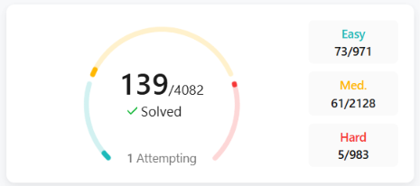

**Rosemariya Roy**

Student at Amity University Mumbai(2024-28).

Working on Backend+AI/ML projects. 

Skills:

**Frontend**: 
REACT JS ,HTML, CSS

**BACKEND**: 
PYTHON , DJANGO

**AI/ML**: 
Scikit-Learn, Python.

**CS Fundamentals**: 
DBMS, OS, CN, DSA, OOPS.

